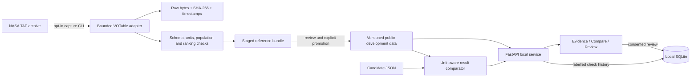

# Architecture and release boundaries

The first usable product helps astronomy researchers inspect archive questions and compare result tables. It is a local workbench with a Python package underneath. It does not yet generate natural-language answers.

## Boundaries that exist today

| Layer | Responsibility | Failure behaviour |
|---|---|---|
| Contracts | Question identity, columns, units, tolerance, order, decision | Invalid payloads rejected |
| Archive | Read-only SELECT, 10,000-row and 8 MiB caps, timeout, bounded retry | Error, unavailable, or partial; never converted to zero |
| Capture | Raw responses, schema, declared units, independent aggregate controls | Failed checks block promotion; stage remains inspectable |
| Evidence | Byte hashes and query identity checked at startup | App refuses startup on evidence mismatch |
| Scorer | One-to-one multiset matching; ordered tasks; physical unit conversion | Empty/incomplete/oversized comparisons inconclusive |
| API | Offline evaluation, request size and host/origin checks | No arbitrary query execution or model credentials |
| Browser | Source, units, saved-data dates, uncertainty, labelled self-checks | Visible errors and no silent success |
| Storage | SQLite transactions, local notes and run provenance | Bounded record count; explicit export |

The API uses the same comparison function as the CLI. The browser has no third-party scripts, analytics, fonts, or paid services. A package install and a fresh live capture require network access; normal workbench operation does not.

`TapClient` is a transport for curated developer-owned queries, **not an SQL security sandbox**. Its simple query guards are not an authorization boundary. The web application deliberately provides no query-execution endpoint. Capture is single-process and sequential, with a one-second minimum request interval; it is not a distributed rate limiter.

## Scientific invariants

1. A result column must retain its meaning. Matching equal values under unrelated column names is not accepted.
2. Numeric equality requires a declared compatible unit and conversion where applicable. Counts use zero tolerance; other tolerances belong to the question contract.
3. Multiplicity matters. Ordered questions also require the declared ordering and tie-break rule.
4. Missing, overflowed, malformed and unavailable responses cannot become successful empty answers.
5. `ps` reference rows and `pscomppars` planet rows are different populations. Preferred-solution filters are question-dependent.
6. `TOP ... ORDER BY` is quarantined because live probes showed incorrect global ranking. The ranking item captures all 6,395 non-null radii within the cap, checks ordering, compares population count and maximum with a separate query, then takes ten locally.
7. Saved data reproduces a recorded observation. Sequential queries are not an atomic database snapshot, and replay does not establish present-day archive truth.
8. Machine checks and a matching result do not approve scientific interpretation. All seed questions still require expert review.

## Deliberate scope limits

The public set exposes references for inspection and is unsuitable as a hidden test set. Model-facing export omits queries and expected decisions, but the public answers remain discoverable. A future evaluation needs family-separated private holdouts, frozen prompts, recorded model versions, complete failure denominators and paired uncertainty estimates.

No model comparison, faithfulness judge, retrieval pipeline, chat agent, MCP runner, automatic reference promotion or multi-archive support is implemented yet. These depend on a reviewed question contract. No performance leaderboard is fabricated from self-checks.

Local use needs no account. Internet hosting needs authentication, per-user data separation, cross-process quotas, retention/deletion policy, TLS, operational monitoring, backups with restore testing and an abuse review. Changing the bind address alone is not a production deployment.

## Next architecture decisions

Use a small worker queue only when live execution or model calls are introduced. Keep the archive adapter, model provider, scorer and storage separate. Preserve tool traces, model/version, prompt hash, schema hash, costs, attempts, latency and failure origin in each future experiment. Use a dedicated held-out store; never expose it through these public development endpoints. Prefer one well-reviewed archive over broad unvalidated coverage.
